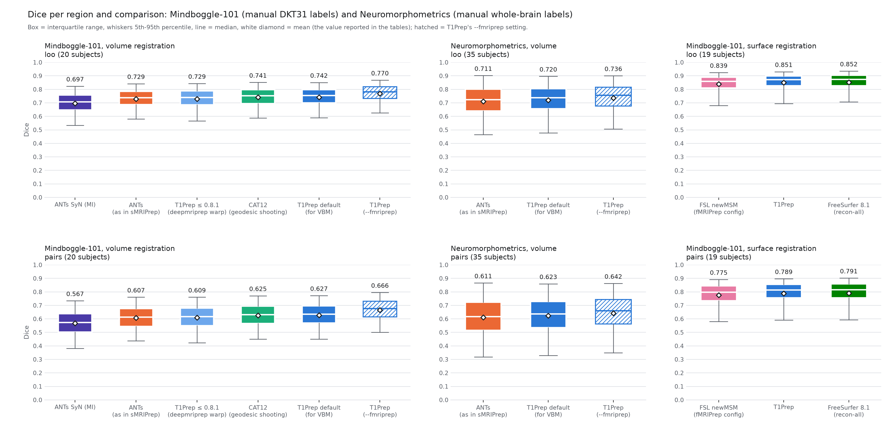

# Registration accuracy on Mindboggle-101

All numbers are Dice between manual DKT31 cortical labels carried into a
common space by the transform under test. One protocol for every arm: nothing
but the registration differs.

* **`pairs`** — every two subjects compared directly. No atlas is involved, so
  this isolates registration alone. Comparable to the numbers surface
  registration papers report.
* **`loo`** — a leave-one-out majority-vote atlas built from the other N−1
  subjects, applied to the held-out subject. The FreeSurfer-style protocol;
  measures registration *and* the atlas the group forms.
* **`atlas`** — the same, but with the subject left *in* the atlas. Inflates
  every arm by 0.009-0.012, about the CAT12-vs-T1Prep gap, because each subject
  votes for the answer it is scored against. Not used for any number below;
  see [How the protocols are built](../README.md#protocols) for the
  construction and the measured bias.

Ground truth never passes through a second registration: labels are attached
to each subject's own anatomy geometrically, and only then moved.

---

## Volume registration — 20 subjects

Stratified subset (`../data/subset20.txt`), MNI152NLin2009cAsym, identical
1.5 mm grid, identical brain-extracted inputs, identical scoring.

| method | LOO | pairs | time / subject |
|---|---|---|---|
| Affine only (Mindboggle's own) | 0.5173 | 0.3317 | — |
| ANTs SyN, Mattes MI 100×70×50×20 | 0.6972 | 0.5672 | ~1 min |
| **ANTs — fMRIPrep's exact config** | 0.7133 | 0.5854 | ~9 min |
| T1Prep ≤ 0.8.1 — deepmriprep's warp network | 0.7289 | 0.6085 | ~40 s |
| **CAT12 — geodesic shooting** | 0.7410 | 0.6249 | 5-15 min |
| **T1Prep — geodesic shooting** | **0.7696** | **0.6663** | ~75 s |

T1Prep registers by geodesic shooting from the release after 0.8.1; up to
0.8.1 it ran deepmriprep's warp network.  Paired differences, with 95 %
intervals from a subject-level bootstrap (4000 resamples, a pair weighted by
both its subjects):

| | Δ LOO | Δ pairs | better |
|---|---|---|---|
| T1Prep's shooting − its deepmriprep warp | +0.041 [+0.037, +0.045] | +0.058 [+0.052, +0.063] | 20/20 subjects, 190/190 pairs |
| T1Prep's shooting − CAT12 | +0.029 [+0.025, +0.032] | +0.042 [+0.036, +0.046] | 20/20 subjects, 189/190 pairs |
| T1Prep's shooting − ANTs (fMRIPrep config) | +0.056 [+0.050, +0.063] | +0.081 [+0.073, +0.089] | 20/20 subjects, 190/190 pairs |

T1Prep's times are its whole volume pipeline on an M2 Ultra with MPS; the
shooting takes 36 s of it on libCAT's default four threads (29 s on eight),
deepmriprep's network took 8 s on MPS and 22 s on the CPU.

### Geodesic shooting

T1Prep's registration is CAT12's optimised geodesic shooting (`run_Shooting`
in CAT26's `cat_main_registration.m`, on SPM's shooting primitives), ported to
C in CAT-Surface (`cat_surf.vol_shoot`); on these 20 subjects the port
reproduces CAT26's deformations to 7.6e-5 voxels.  It registers T1Prep's own
affine-registered GM and WM maps — what the deepmriprep network received —
onto CAT12's 1.5 mm shooting templates (`Template_0..4_GS`), and T1Prep
composes the field with its affine into `y_`.

**The gap to CAT12 was the registration, not the segmentation.**  With
CAT12's own settings, the shooting on T1Prep's maps scores 0.7421 / 0.6274,
level with CAT12's whole pipeline (+0.001 [−0.004, +0.006] LOO, 14 of 20
subjects better).  deepmriprep's network was trained to imitate CAT12's
deformations and fell short of them by 0.013.

**T1Prep does not run CAT12's settings.**  It runs every scheduled
Gauss-Newton iteration with half of CAT12's regularisation, the setting with
the best label accuracy among these (same 20 subjects, same scoring):

| shooting settings | LOO | pairs | det J, 1st–99th percentile | median \|log det J\| | time |
|---|---|---|---|---|---|
| CAT12's: `regstr` 0.5, CAT12's regularisation | 0.7421 | 0.6274 | 0.61–1.31 | 0.120 | 13 s |
| every scheduled iteration (`regstr` 1) | 0.7512 | 0.6394 | 0.61–1.33 | 0.124 | 30 s |
| half the regularisation | 0.7596 | 0.6529 | 0.54–1.45 | 0.143 | 13 s |
| **both (T1Prep)** | **0.7696** | **0.6663** | 0.54–1.45 | 0.146 | 30 s |
| a quarter of the regularisation | 0.7690 | 0.6657 | 0.48–1.60 | 0.167 | 10 s |

CAT12's `regstr` 0.5 moves on to the next resolution level after about three
Gauss-Newton iterations; running every scheduled one adds +0.009 at nearly
unchanged regularity, halving the regularisation +0.018, both together +0.028
(20 of 20 subjects better).  A quarter of the regularisation adds nothing
more and costs regularity.  The Jacobian determinants are taken inside the
brain (the template's GM + WM above 0.5) and are medians over the subjects; no
setting folds a voxel.  Times are the shooting alone, 8 threads on an M2
Ultra.

* **The gain costs regularity.**  The Jacobians spread from 0.61–1.31 to
  0.54–1.45.  Cortical-label Dice rewards flexible deformations, while CAT12's
  regularisation was tuned for VBM, where the modulated maps carry the
  Jacobian; whether half of it is right for `mwp` is not measured here.
* **CAT12's 1 mm templates add +0.003, at three times the time.**  The
  matching term sums over the template's voxels, the regulariser integrates
  over space, so the regulariser has to be weighted per 1.5 mm voxel on the
  1 mm templates too, as cat-surf does: then the 1 mm series is as regular
  as the 1.5 mm one (Jacobians 0.50–1.52) and scores 0.7730 / 0.6716
  (+0.003 [+0.003, +0.004], 20 of 20 subjects), at ~90 s.  Weighted per 1 mm
  voxel it was under-regularised (0.38–1.80, the only setting with folded
  voxels) and scored 0.008 lower.  T1Prep keeps the 1.5 mm templates.

### For replacing ANTs in fMRIPrep

fMRIPrep normalises with `antsRegistration` via
`niworkflows.interfaces.norm.SpatialNormalization`, parameterised by
`niworkflows/data/t1w-mni_registration_precise_000.json`: Rigid + Affine
(Mattes, 56 bins, 25 % regular sampling, 100×100) then **SyN with CC radius 4,
100×70×50×20**, transform parameters `[0.1, 3.0, 0.0]`. `tools/ants_fmriprep.sh`
reproduces that command line field for field, run with the real ANTs binaries
(2.6.5).

T1Prep is **more accurate than that configuration** (+0.056 LOO, +0.081 pairs)
at a fraction of the runtime — ~35 s of shooting versus ~9 minutes
of CC-metric optimisation. Anatomical normalisation is a dominant cost in
fMRIPrep, so the runtime argument is at least as strong as the accuracy one.
deepmriprep's network, which T1Prep ran up to 0.8.1, was ahead of it by
+0.016 / +0.023.

Two caveats:

* The shooting matches T1Prep's GM and WM maps to CAT12's tissue templates,
  ANTs the T1w intensities to a T1w template, so T1Prep's comparison includes
  its segmentation.  Both optimise every subject from scratch; deepmriprep's
  network instead mapped with a prior learned for MNI152NLin2009cAsym, which
  does not transfer to a template it was not trained on.
* DKT31 is cortical parcels only. Nothing here measures subcortical alignment,
  which fMRIPrep users also depend on.

---

## Surface registration

### T1Prep vs FSL newMSM vs FreeSurfer 8.1 — 19 subjects

The 19 subjects of `subset20` that FreeSurfer 8.1 processed (all but
`MMRR-3T7T-2-1`, excluded due to preprocessing issues), the same manual labels
and the same protocol.  Every arm is scored on a 164k mesh, with the labels
attached to the midthickness (FreeSurfer) or the central surface (T1Prep),
which is the same geometry; see [the attachment
surface](#the-attachment-surface-is-a-confound-and-it-is-a-large-one).  T1Prep
and newMSM register T1Prep's surfaces; FreeSurfer registers its own, so its
row measures surface reconstruction and spherical registration together, and
the two cannot be separated because each pipeline's sphere is tied to its own
mesh.  T1Prep is 0.8.1 with the relaxed input sphere (`CAT_Surf2Sphere
-relax`, cat-surf 1.1.5) and with Spherical Demons applying its global
rotation to the sphere instead of the warp (CAT-Surface #34), as the next
release runs it.

| arm | registration | target | LOO | pairs | time / hemisphere |
|---|---|---|---|---|---|
| **T1Prep** | **relaxed sphere, Spherical Demons → fsaverage** | fsaverage 164k | **0.8507** | **0.7892** | ~50 s |
| FSL newMSM | fMRIPrep's MSMSulc config, from T1Prep's sphere and `sulc` | fs_LR 164k | 0.8391 | 0.7751 | +4 min |
| **FreeSurfer 8.1** | **recon-all: `mris_sphere`, `mris_register` → fsaverage** | fsaverage 164k | **0.8516** | **0.7906** | ~12 min |

Paired differences, with 95 % intervals from a subject-level bootstrap (4000
resamples, a pair weighted by both its subjects):

| | Δ LOO | Δ pairs | subjects better (LOO) |
|---|---|---|---|
| T1Prep − FreeSurfer | −0.001 [−0.009, +0.011] | −0.001 [−0.017, +0.018] | 9/19 |
| T1Prep − newMSM | +0.012 [+0.009, +0.014] | +0.014 [+0.009, +0.019] | 18/19 |
| newMSM − FreeSurfer | −0.012 [−0.020, −0.002] | −0.016 [−0.028, +0.002] | 1/19 |

T1Prep and FreeSurfer are level within the noise of 19 subjects: the right
hemisphere is ahead (+0.004 / +0.008), the left trails (−0.006 / −0.011).  The
pial attachment gives the same picture (FreeSurfer 0.8197 / 0.7425, T1Prep
0.8164 / 0.7389).  newMSM is below both.  On all 20 subjects T1Prep scores
0.8515 / 0.7903 (0.8488 / 0.7914 on fsaverage 32k with its cortex mask) and
newMSM 0.8400 / 0.7763; T1Prep's fs_LR sphere for fMRIPrep (`desc-msmsulc`,
Spherical Demons onto fs_LR) reaches 0.8536 / 0.7926.

CAT-Surface #34 adds +0.004 [+0.002, +0.008] (LOO) and +0.007 [+0.002,
+0.013] (pairs) to T1Prep's registration on all 20 subjects, with 17 of 20
subjects and 157 of 190 pairs better: Spherical Demons used to fold its
global rotation into the warp, whose elastic prior undid it wherever the data
term is weak.  newMSM gains +0.003 / +0.006 through it (intervals just above
zero), because its affine start is regressed onto T1Prep's fs_LR sphere.  The
`desc-msmsulc` sphere is the exception (−0.001 / −0.001): T1Prep's
`write_msm_sphere()` runs the global rotation search a second time on a start
it has already aligned rigidly, that search lands a median 5° off (up to
13°), and before #34 the warp partly shrank that rotation back.  Without the
second search it is 0.8546 / 0.7942.

Times are per hemisphere.  T1Prep's is the sphere (19 s) plus Spherical
Demons (30 s) on an M2 Ultra, one process; T1Prep runs the two hemispheres in
parallel.  newMSM starts from T1Prep's registration and adds ~4 min (two
OpenMP threads).  FreeSurfer's is `mris_register` aligning `?h.sphere` to the
fsaverage folding atlas, 8.4 min (median; IQR 7.2-12.6, range 4.7-55.7) read
from `FSRUNTIME@` in the `rca-surfreg` logs (38 of 38 hemispheres), plus
~3.5 min for the `mris_sphere` that makes `?h.sphere`.  Two caveats on those:
every run reports **`1 threads`** despite the command line requesting
`-threads 24`, so they are single-core timings; and the spread is
cohort-structured rather than random -- the four MMRR subjects take 59-96 min
each while every NKI, OASIS and HLN subject finishes in 12-21 min.

### The attachment surface is a confound, and it is a large one

Which surface the labels attach to moves Dice by more than most method
differences here, so it has to be fixed on a principled basis and held
identical across arms:

| pipeline | mid − pial (LOO) | mid − pial (pairs) |
|---|---|---|
| T1Prep | +0.0344 | +0.0503 |
| FreeSurfer | +0.0318 | +0.0481 |

Mindboggle's labelled surfaces sit on the **pial**, so the pial gives the
smallest vertex-to-label distance and the *worst* transfer: at the pial the
two banks of a sulcus are in contact, so a nearest-neighbour lookup jumps
across the fundus.  Counting vertices whose label matches none of their 1-ring
neighbours (OASIS-TRT-20-2 lh, FreeSurfer mesh):

| mesh | distance | unlabelled | speckle |
|---|---|---|---|
| pial | 0.44 mm | 0.4 % | **0.502 %** |
| mid | 1.12 mm | 0.5 % | **0.175 %** |
| white | 2.14 mm | 13.6 % | 0.117 % |

White has the least speckle but loses 13.6 % of vertices past the 3 mm cutoff.
Midthickness is the only geometry good on both counts - and it is what
T1Prep's central surface already is, so the two pipelines are compared on
equivalent geometry rather than on a choice tuned to the outcome.

That the mid > pial > white ordering appears in **both** pipelines is the
check that this is a property of the labelled data, not of either pipeline.

### Setup notes

The two pipelines use opposite coordinate conventions, verified per subject:

| | frame | without the correction |
|---|---|---|
| FreeSurfer surfaces | tkrRAS (`--reference-glob none`) | correct as-is |
| T1Prep surfaces | scanner RAS (`+c_ras`) | 134--166 mm off |

Applying the wrong one is not subtle - it misses by the size of the head -
but it only shows up on subjects whose `c_ras` is non-zero, and OASIS-TRT-20's
is exactly zero, so a single-cohort check would pass either way.

Scoring against FreeSurfer 8.1's own `fsaverage/surf/?h.sphere` and against
T1Prep's shipped `templates_surfaces_164k/?h.sphere.freesurfer.gii` gives
identical results to four decimals: they are the same mesh, vertex for vertex.

### Reading the newMSM result

newMSM is run exactly as sMRIPrep runs MSMSulc: the config
(`MSMSulcStrainFinalconf`) and both reference files are copied verbatim from
sMRIPrep, and the four preprocessing steps (affine regression onto the
fsLR-registered sphere, apply, re-sphere to radius 100, **invert sulc**) are
reproduced.  Its starting mesh is T1Prep's native sphere, affinely aligned
(where sMRIPrep would use FreeSurfer's `?h.sphere`), and it is driven by
T1Prep's `?h.sulc`.

The newMSM row shown here until October 2026 (0.7317 / 0.6405 on 20 subjects)
was wrong.  Its `sulc` came from cat-surf < 1.1.1, whose curvature type 11 did
not measure depth: on these surfaces it correlates with the correct map at
Spearman 0.00-0.02.  MSMSulc was registering a map without folding
information, and that, not MSM, made most of the 0.08-0.10 lead T1Prep held
here before.

With correct inputs T1Prep stays ahead, by much less: +0.012 / +0.014 on the
19 subjects above, and +0.014 [+0.010, +0.017] / +0.016 [+0.011, +0.021] for
T1Prep's own fs_LR sphere, the one fMRIPrep uses instead of running MSMSulc
(20 subjects; 18 of 20 subjects and 176 of 190 pairs better).  Both the
ordering and its size match the literature: 0.786 vs 0.766 for Spherical
Demons and MSM in Zhao's pediatric comparison, 0.881 vs 0.872 in the
SphereMorph table.  MSMSulc is a deliberately conservative,
strain-regularised *refinement*: it is meant to improve an already-aligned
sphere without introducing areal distortion, and `MSMSulcStrainFinalconf`
limits it to 15 iterations at the finest level with a strain penalty.

Cortical-parcel Dice is not the criterion MSMSulc is optimised for, so this
number should not be read as "MSM is a worse algorithm" - it says that for
carrying fold-defined labels between subjects, T1Prep's registration is
somewhat better than fMRIPrep's MSMSulc on the same surfaces, in a fraction
of the time (~40 s against ~4 min per hemisphere for the step onto fs_LR).

<!---
### Not shown: T1Prep without the relaxed sphere

Kept for later reading.  T1Prep 0.8.1 and earlier registered the sphere as
`CAT_Surf2Sphere` inflates it, without `-relax`; below, that sphere against
the relaxed one on the same central surfaces (20 subjects, fsaverage 32k
unless stated).  Per-region rows: `d20_surf_*_norelax.csv`, from 0.8.1's own
spheres (bit-identical to its output).

#### The input sphere

Spherical Demons does not start from scratch: it deforms the sphere that
`CAT_Surf2Sphere` inflates the central surface to, and inherits that sphere's
distortion.  The inflation compresses the poles and expands the medial wall;
on these 40 hemispheres it maps 19 % of the surface with more than twofold
area distortion.  cat-surf 1.1.5 adds two steps: **`-relax`** pulls the
distances between neighbours (two rings) towards their distances on the
central surface, the distance term of FreeSurfer's `mris_sphere`, and **fold
removal** (on by default) re-embeds the triangles the inflation folds.
T1Prep 0.8.1 gets the fold removal through that default; `-relax` is on from
the next release.

Same T1Prep 0.8.1 central surfaces and the same scoring; only the sphere
differs, and in the last row Spherical Demons as well (CAT-Surface #34: the
global rotation applied to the sphere, not to the warp):

| sphere | LOO | pairs | Δ LOO [95 % CI] | Δ pairs [95 % CI] | better |
|---|---|---|---|---|---|
| inflation only (T1Prep ≤ 0.8.0) | 0.8120 | 0.7454 | | | |
| + fold removal (T1Prep 0.8.1) | 0.8119 | 0.7454 | −0.0000 | +0.0000 | |
| + `-relax` (cat-surf 1.1.5) | 0.8445 | 0.7845 | +0.0326 [+0.0273, +0.0375] | +0.0391 [+0.0315, +0.0460] | 20/20 subjects, 187/190 pairs |
| **+ `-relax`, #34** (next release) | **0.8488** | **0.7914** | **+0.0368** [+0.0323, +0.0412] | **+0.0460** [+0.0396, +0.0517] | 20/20 subjects, 190/190 pairs |

Δ against inflation only, scored at fsaverage 32k; the intervals come from a
subject-level bootstrap (4000 resamples, a pair weighted by both its
subjects).

| sphere | area-weighted mean \|log₂ area ratio\| | area distorted > 2× | folded triangles: sphere / after registration | time |
|---|---|---|---|---|
| inflation only | 0.61 | 18.9 % | 1586 in 23 hemispheres / 1554 in 14 | 9 s |
| + fold removal | 0.61 | 18.9 % | 0 / 452 in 2 | 9 s |
| + `-relax` | 0.31 | 1.3 % | 0 / 0 | 19 s |

Area ratio: the area of each triangle on the sphere over its area on the
central surface, both normalised to their totals; medians over the 40
hemispheres.  Time: one hemisphere, one process, M2 Ultra; Spherical Demons
adds ~30 s either way.

* **The gain is systematic.**  Every subject improves under LOO (+0.021 to
  +0.056 with #34, +0.005 to +0.051 without), the right hemisphere about
  twice as much as the left (+0.047 vs +0.026).  It is concentrated in the
  right lateral temporal lobe: middle temporal +0.229 (median 0.64 → 0.87,
  every subject better), inferior temporal +0.179, transverse temporal
  +0.091, then postcentral +0.080.  That matches the whole-fold slip (~14°)
  of the right inferior temporal gyrus which comparing T1Prep's registration
  with recon-all's had traced to the inflated sphere.
* **One local failure is left.**  The two registrations differ by 2° (median
  per hemisphere; 95th percentile 8°), and in a few hemispheres by a whole
  fold.  Mostly that is the correction above, but with cat-surf 1.1.5 two of
  the 40 went the wrong way: OASIS-TRT-20-16 rh lost its parahippocampal and
  entorhinal labels (LOO 0.72 → 0.00 and 0.68 → 0.15), MMRR-3T7T-2-2 lh its
  pre- and postcentral (0.84 → 0.32 and 0.61 → 0.23).  The first was a defect
  in Spherical Demons, not in the sphere: it folded its global rotation into
  the warp, whose elastic prior undid the rotation wherever the data term is
  weak, and the relaxed sphere happened to start that gyrus 13° into the
  template's medial wall.  With #34 it is 0.77 and 0.64.  MMRR-3T7T-2-2 lh
  stays (0.54 and 0.31): its central and postcentral sulci are equally deep,
  on FreeSurfer's pial surface as well, so it is registered correctly only
  from starts at most 2-6° anterior of the right position (other hemispheres
  recover from 19°), and the relaxed sphere starts it 11° anterior.  No
  region's mean drops any more: the lowest is rh pericalcarine at −0.001.
* **Fold removal alone changes no Dice** (no region's mean by more than
  0.002).  Its value is a valid map, and even that does not survive
  registration without `-relax`: Spherical Demons folds two of the 40 spheres
  again (188 and 264 triangles, about half of them the ones fold removal had
  straightened).  Fold removal leaves those regions crushed, with triangles
  500-2000× smaller than the median one, and the warp flips them.  With
  `-relax` none is folded.
* **The fs_LR spheres for fMRIPrep gain as much.**  `fsLR` (`desc-reg`, the
  fsaverage registration carried into fs_LR) goes from 0.8167 / 0.7452 to
  0.8515 / 0.7906, `msm` (`desc-msmsulc`, the sphere fMRIPrep resamples to
  fs_LR with) from 0.8211 / 0.7519 to 0.8536 / 0.7926, every pair better
  (0.8480 / 0.7839 and 0.8546 / 0.7936 with cat-surf 1.1.5).
* **Nothing else moved.**  T1Prep 0.8.1 without `-relax` reproduces the 0.7.x
  run shown here before (fsaverage LOO −0.003, pairs ±0.000; 164k ±0.001),
  so the gain is the sphere's alone.

#### newMSM from the unrelaxed sphere

| newMSM inputs | LOO | pairs |
|---|---|---|
| `sulc` from cat-surf < 1.1.1, sphere without `-relax` (shown until October 2026) | 0.7317 | 0.6405 |
| correct `sulc`, sphere without `-relax` | 0.7998 | 0.7256 |
| correct `sulc`, relaxed sphere | 0.8366 | 0.7705 |
| correct `sulc`, relaxed sphere, affine start from the #34 fs_LR sphere | 0.8400 | 0.7763 |

Correcting the map gains +0.068 (LOO) and +0.085 (pairs), with every subject
and every pair better; T1Prep's own registrations moved by no more than 0.004
between the two T1Prep versions involved, so the gain is the map's.  The
relaxed sphere then adds +0.037 [+0.032, +0.042] and +0.045 [+0.038, +0.052],
as much as it gives Spherical Demons, and #34 another +0.003 / +0.006 through
the fs_LR sphere newMSM's affine start is regressed onto.

#### FreeSurfer against T1Prep without `-relax` (19 subjects, 164k)

| attachment surface | FreeSurfer 8.1 | T1Prep 0.7.6 |
|---|---|---|
| midthickness / central | 0.8516 / 0.7906 | 0.8143 / 0.7427 |
| pial | 0.8197 / 0.7425 | 0.7900 / 0.7066 |

With the unrelaxed sphere FreeSurfer led by ~0.037 (LOO) and ~0.048 (pairs),
and the margin held whichever attachment surface was chosen (+0.030 to
+0.047).  T1Prep's mid − pial difference was +0.0243 / +0.0362.
-->

---

## Distributions

The means in the tables above summarise wide distributions, and the boxplots
change how several of them should be read.

**The spread within a method dwarfs the differences between methods.** Every
non-linear volume arm has an interquartile range about 0.10 wide (LOO) or
0.13 (pairs), the surface arms about 0.08 and 0.10-0.11, while the means
separate by 0.01-0.03.  Which region is being measured
matters far more than which of these methods produced the registration - the
ranking is a statement about averages over many regions, not a prediction for
any single parcel.

**Affine is not merely lower, it is a different kind of distribution.** Its
pairwise IQR spans 0.000-0.526 - more than a quarter of region-pairs get
essentially *no* overlap from an affine alignment - against 0.52-0.66 for
ANTs.  69 % of its pairwise values fall below 0.5, versus 10-19 % for the
non-linear methods.  That is the gap the non-linear step actually closes.

**The three surface arms differ little.** T1Prep and FreeSurfer have nearly
the same box (pairwise IQR 0.099 and 0.104, lower whiskers 0.59 for both,
2.2 % and 2.6 % of values below 0.5); newMSM's is slightly wider (0.110) and
reaches a little lower (0.58, 2.6 %).  The wide newMSM box shown here before
(IQR 0.199, whisker 0.27, 17.3 % below 0.5) was the `sulc` bug.

**The volume arms overlap heavily.** ANTs, deepmriprep's warp and CAT12
have visually similar boxes, consistent with paired differences of
0.012-0.016; T1Prep's geodesic shooting sits higher, but its lead (0.029 over
CAT12) is still small against the spread.  The ordering is reliable - the
paired intervals exclude zero - but no visible difference should be expected
on any one region.

Regenerate with `tools/plot_dice.py`.

## Comparison with published numbers

Published volume-registration results are not directly comparable, for three
reasons:

1. **Metric.** Klein 2009 and Ashburner & Friston 2011 report *target overlap*
   = |deformed ∩ target| / |target|, one-sided. Dice is 2|A∩B|/(|A|+|B|).
2. **Structures.** The same methods score 0.75 on LPBA40 and 0.59 on IBSR18 —
   that gap is the label set, not the algorithm. DKT31 is cortex only, the
   hardest case, which is why its affine baseline is 0.33 rather than 0.40–0.60.
3. **Geodesic shooting is not in Klein 2009** — that is Ashburner & Friston
   2011. Klein's SPM entry is DARTEL.

Improvement over affine is the most defensible cross-study quantity:

| study | dataset | affine | best | gain |
|---|---|---|---|---|
| Ashburner & Friston 2011 | IBSR18 | 0.40 | GS2 0.590 | +0.19 |
| Ashburner & Friston 2011 | LPBA40 | 0.60 | GS2 0.751 | +0.15 |
| Klein 2009 (SyN/ART) | IBSR18 | 0.40 | ~0.55 | +0.15 |
| this work (pairs) | Mindboggle-101 | 0.33 | T1Prep shooting 0.666 | +0.33 |

That geodesic shooting leads here -- CAT12's and T1Prep's -- is consistent
with Ashburner & Friston reporting shooting ahead of DARTEL and of Klein
2009's best on both datasets.

---

## Provenance

* Data: Mindboggle-101, CC-BY (Klein & Tourville 2012).
* ANTs 2.6.5 (macOS ARM64 binaries), `antsRegistration` + `antsApplyTransforms`.
* CAT12 via `cat_batch_cat.sh -ns -p 4` (geodesic shooting, surfaces skipped).
* FSL newMSM built against FSL 6.0.7.23; config and reference surfaces copied
  verbatim from sMRIPrep (`tools/msm_data/`).  On macOS the build needs
  `$FSLDIR/bin/make` (Apple ships GNU Make 3.81, which cannot parse the
  `define VAR =` syntax in FSL's `rules.mk` and silently generates no compile
  rules) and libomp via `USRCXXFLAGS`/`USRLDFLAGS` - see
  `tools/build_newmsm.sh`.
* T1Prep deformations are the SPM-format `y_*.nii` (5-D, native mm, affine and
  non-linear composed).
* T1Prep's geodesic shooting arm (`d20_t1prep_shoot.csv`): T1Prep after 0.8.1
  (registration by `cat_surf.vol_shoot`, which needs cat-surf 1.1.6), run on
  the CPU; the shooting settings table re-runs the shooting on the same maps
  (`tools/run_volshoot.py`).  The deepmriprep arm (`d20_mni.csv`) is T1Prep's
  run of 2026-09-04; T1Prep 0.8.1 reproduces it to 0.0001.
* T1Prep surface arms (`d20_surf_*`, `d19_t1p_*`): T1Prep 0.8.1 with
  cat-surf 1.1.5 plus CAT-Surface #34 (Spherical Demons applies its global
  rotation to the sphere), the sphere computed with `relax=True` as the next
  release does it; an end-to-end run with that change gives bit-identical
  spheres.  The `fsLR` and `msm` spheres are written as `--fmriprep` writes
  them.  The `*_norelax.csv` arms are 0.8.1's own output with cat-surf 1.1.5.
* newMSM (`d20_surf_newmsm.csv`, `d19_newmsm.csv`) starts from those spheres
  (its affine is regressed onto the `fsLR` sphere above), with `?h.sulc` from
  cat-surf 1.1.5 (`tools/gen_sulc.py`), 2 OpenMP threads per hemisphere.
* FreeSurfer 8.1 (`d19_fs81*.csv`): recon-all, scored through its own
  `?h.sphere.reg`, with the labels attached to the midthickness
  (`tools/prepare_fs_midthickness.py`) and `--reference-glob none`.
* Per-region, per-comparison Dice for every arm is in `d20_*.csv` (20
  subjects) and `d19_*.csv` (the 19 with FreeSurfer output).
